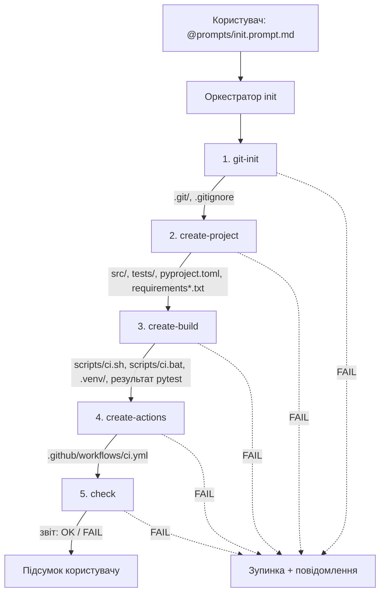

# Архітектура AI-агента Build Engineer

**Варіант 2:** Python, `venv`, `pytest`.

Цей документ описує, як побудований автономний агент Build Engineer: які задачі він бере на себе, як його адаптовано під Cursor, з яких навичок (skills) і команд він складається, як дані передаються між етапами і як оркестратор обробляє помилки.

---

## 1. Які проблеми вирішує агент

Перша проблема — **рутинні операції**. Кожен новий Python-проєкт починається з того самого набору кроків: ініціалізувати git-репозиторій, створити `.gitignore`, підготувати структуру каталогів `src/` і `tests/`, написати мінімальний код і тест, описати залежності, створити віртуальне середовище, написати скрипти збірки і налаштувати CI. Вручну це займає час і легко забути щось. Агент виконує ці кроки сам, завжди в однаковому порядку і з однаковим результатом.

Друга проблема — **помилки конфігурації середовища**. Найчастіше це встановлення пакетів у глобальний інтерпретатор замість `venv`, різні версії Python у розробників і в CI, незафіксовані залежності, відсутній `__init__.py`, через що `pytest` не бачить модуль, або неправильний `PYTHONPATH`. Агент завжди створює ізольоване середовище `.venv`, встановлює залежності лише в нього, фіксує їх у `requirements.txt` / `requirements-dev.txt` і налаштовує `pytest` через `pyproject.toml`. Тому тести поводяться однаково на будь-якій машині.

Третя проблема — **кросплатформність збірки**. На Linux/macOS і на Windows по-різному активується `venv` (`.venv/bin/activate` проти `.venv\Scripts\activate.bat`), по-різному називаються інтерпретатори (`python3` проти `python`/`py`) і по-різному обробляються коди повернення. Агент генерує два еквівалентні скрипти, `scripts/ci.sh` і `scripts/ci.bat`, з однаковою логікою, а також workflow GitHub Actions з матрицею `ubuntu-latest`, `windows-latest`, `macos-latest`. Так перевіряється, що проєкт справді збирається і проходить тести на всіх трьох ОС.

---

## 2. Адаптація під середовище Cursor

Початкова концепція агента орієнтована на GitHub Copilot (custom agents, prompt files і skills у каталозі `.github/`). У Cursor ті самі ролі виконують інші механізми. Маніфест агента підключається через Cursor Rules, навички лежать у `skills/`, а команди є prompt-файлами в `prompts/`, які викликаються через `@` у Composer Agent.

**Маніфест агента**
- GitHub Copilot: `.github/agents/build-engineer.agent.md`
- Cursor: `.cursor/rules/build-engineer.mdc`

**Глобальні інструкції**
- GitHub Copilot: `.github/copilot-instructions.md`
- Cursor: `.cursor/rules/*.mdc` з `alwaysApply: true`

**Навички (skills)**
- GitHub Copilot: `.github/skills/<name>/SKILL.md`
- Cursor: `skills/<name>/SKILL.md`

**Команди**
- GitHub Copilot: `.github/prompts/<name>.prompt.md`, виклик `/name`
- Cursor: `prompts/<name>.prompt.md`, виклик `@prompts/<name>.prompt.md`

**Середовище виконання**
- GitHub Copilot: Copilot Chat (Agent mode)
- Cursor: Composer (режим Agent)

Цільова структура репозиторію агента:

```text
ADCS_ai_agent/
├── .cursor/
│   └── rules/
│       └── build-engineer.mdc      # маніфест агента: роль, правила, заборони, Definition of Done
├── .github/
│   └── workflows/
│       └── ci.yml                  # GitHub Actions: матриця Ubuntu / Windows / macOS
├── skills/
│   ├── project-scaffold/SKILL.md
│   ├── build-and-test/SKILL.md
│   └── github-actions/SKILL.md
├── prompts/
│   ├── git-init.prompt.md
│   ├── create-project.prompt.md
│   ├── create-build.prompt.md
│   ├── create-actions.prompt.md
│   ├── check.prompt.md
│   └── init.prompt.md              # оркестратор: запускає всі етапи по черзі
├── scripts/
│   ├── ci.sh                       # збірка й тести для Linux / macOS
│   └── ci.bat                      # збірка й тести для Windows
├── src/
│   └── hello_world/
│       ├── __init__.py
│       └── main.py                 # greet(), add(), main()
├── tests/
│   ├── __init__.py
│   └── test_main.py                # test_greet(), test_basic_addition()
├── docs/
│   ├── architecture.md             # архітектура агента (цей документ)
│   └── usage.md                    # інструкція з використання
├── pyproject.toml                  # метадані проєкту + конфігурація pytest
├── requirements.txt                # runtime-залежності
├── requirements-dev.txt            # залежності для розробки (pytest)
├── .gitignore                      # .venv/, __pycache__/, .pytest_cache/, *.pyc
└── README.md                       # опис проєкту, власник, інструкція запуску
```

Маніфест агента в Cursor — це правило `.cursor/rules/build-engineer.mdc` з `alwaysApply: true`, тож Cursor автоматично додає його до контексту кожного запиту. Він задає роль агента (Build & Automation Engineer для Python-проєкту), область відповідальності, правила роботи з файлами (відносні шляхи, ідемпотентність, виклик у `ci.yml` лише `scripts/ci.sh` / `scripts/ci.bat`), заборонені дії та критерії Definition of Done. Prompt-файли з `prompts/` описують, що зробити на конкретному етапі, і в тексті посилаються на відповідний `skills/<name>/SKILL.md`, де описано, як саме це зробити.

---

## 3. Навички (skills)

### 3.1. `skills/project-scaffold`

Ця навичка створює кросплатформний Hello World-проєкт на Python. Вона генерує пакет у `src/` (layout `src/hello_world/`), точку входу, мінімальний модульний тест, файли залежностей і конфігурацію `pytest`. На вході навичка отримує назву пакета (за замовчуванням `hello_world`) і мінімальну версію Python (за замовчуванням `3.10`).

Результат роботи:

```text
src/hello_world/__init__.py
src/hello_world/main.py          # greet() -> "Hello, World!", add(a, b) -> a + b, main()
tests/__init__.py
tests/test_main.py               # test_greet(), test_basic_addition() (BasicAddition)
requirements.txt                 # runtime-залежності (може бути порожнім)
requirements-dev.txt             # pytest
pyproject.toml                   # метадані + [tool.pytest.ini_options]
.gitignore                       # .venv/, __pycache__/, .pytest_cache/, *.pyc
```

У коді використовується лише стандартна бібліотека, без шляхів чи викликів, прив'язаних до ОС. Тому проєкт однаково запускається на Linux, Windows і macOS. У `pyproject.toml` задаються `testpaths = ["tests"]` і `pythonpath = ["src"]`, щоб `pytest` знаходив пакет без ручного налаштування `PYTHONPATH`.

Файл `tests/test_main.py` містить два обов'язкові тести. `test_greet()` перевіряє, що `greet()` повертає рядок `"Hello, World!"`. `test_basic_addition()` (тест BasicAddition, якого вимагає методичка) перевіряє базову логіку функції `add()`, наприклад `assert add(2, 3) == 5`. Обидва тести запускаються однаково на всіх ОС через `python -m pytest` у скриптах `scripts/ci.sh` / `scripts/ci.bat` і в GitHub Actions.

### 3.2. `skills/build-and-test`

Ця навичка створює скрипти збірки `scripts/ci.sh` і `scripts/ci.bat` та описує, як їх запускати. Обидва скрипти виконують однакову послідовність. Спочатку визначається інтерпретатор Python, потім створюється `.venv`, якщо його ще немає. Далі в середовищі оновлюється `pip`, встановлюються `requirements.txt` і `requirements-dev.txt`, запускається `python -m pytest` і, нарешті, smoke-запуск `python -m hello_world.main`.

`ci.sh` починається з `set -euo pipefail` і використовує `.venv/bin/python`. `ci.bat` використовує `.venv\Scripts\python.exe` і після кожної команди перевіряє `if errorlevel 1 exit /b 1`. В обох скриптах активація середовища не потрібна, бо команди викликають інтерпретатор із `venv` напряму за повним шляхом. Через це поведінка не залежить від оболонки. Будь-яка помилка завершує скрипт ненульовим кодом повернення, і на цей код спирається і оркестратор, і GitHub Actions.

### 3.3. `skills/github-actions`

Ця навичка генерує workflow `.github/workflows/ci.yml`. Він запускається на `push` і `pull_request` і містить один job `build` з матрицею:

```yaml
strategy:
  fail-fast: false
  matrix:
    os: [ubuntu-latest, windows-latest, macos-latest]
    python-version: ["3.10", "3.12"]
runs-on: ${{ matrix.os }}
```

Кроки job: `actions/checkout`, `actions/setup-python` з `matrix.python-version`, а потім виклик скрипта збірки під відповідну ОС. На Windows це `scripts\ci.bat` (`shell: cmd`), на Linux і macOS — `bash scripts/ci.sh`. Отже, CI запускає ті самі скрипти, що й розробник локально, без окремої CI-логіки. `fail-fast: false` у матриці потрібен, щоб падіння на одній ОС не скасовувало перевірку на інших і було видно повну картину сумісності.

---

## 4. Команди, доступні користувачу

Усі команди є prompt-файлами в `prompts/` і викликаються в Cursor Composer (режим Agent) через `@prompts/<name>.prompt.md`. Кожна команда, крім `init`, відповідає одному етапу. Її можна запустити окремо, наприклад щоб перегенерувати лише CI.

**`git-init`** (skill: —)
Ініціалізує git-репозиторій (якщо його ще немає), створює `.gitignore` для Python і перевіряє, що робочий каталог готовий до роботи.

**`create-project`** (skill: `project-scaffold`)
Створює Hello World-проєкт: `src/`, `tests/`, `pyproject.toml`, файли залежностей.

**`create-build`** (skill: `build-and-test`)
Створює `scripts/ci.sh` і `scripts/ci.bat`, робить `ci.sh` виконуваним, створює `.venv` і запускає першу локальну збірку.

**`create-actions`** (skill: `github-actions`)
Створює `.github/workflows/ci.yml` з матрицею Ubuntu / Windows / macOS.

**`check`** (skill: `build-and-test`)
Перевіряє результат: наявність усіх обов'язкових файлів, коректність `venv`, запуск скрипта збірки під поточну ОС, проходження `pytest`. Повертає звіт.

**`init`** (skills: усі)
Оркестратор: послідовно виконує `git-init` → `create-project` → `create-build` → `create-actions` → `check` і зупиняється на першій помилці.

---

## 5. Передача даних між етапами

Етапи обмінюються даними через **файлову систему репозиторію**, тобто через артефакти, створені попереднім етапом, і через **статус завершення** етапу, який оркестратор аналізує перед переходом до наступного. Кожен етап перед стартом перевіряє свої передумови (вхідні артефакти), а після завершення повертає оркестратору статус `OK` або `FAIL` з описом причини.



**`git-init`**
- Вхід: робочий каталог, встановлений `git`
- Вихід: `.git/`, `.gitignore`

**`create-project`**
- Вхід: `.git/`
- Вихід: `src/hello_world/*`, `tests/*`, `pyproject.toml`, `requirements.txt`, `requirements-dev.txt`

**`create-build`**
- Вхід: файли з `create-project`, доступний Python 3.10+
- Вихід: `scripts/ci.sh`, `scripts/ci.bat`, `.venv/`, код повернення першої збірки (0)

**`create-actions`**
- Вхід: `scripts/ci.sh`, `scripts/ci.bat`
- Вихід: `.github/workflows/ci.yml`

**`check`**
- Вхід: усі попередні артефакти
- Вихід: звіт перевірки — список файлів, результат `pytest`, загальний статус

---

## 6. Обробка помилок оркестратором

Оркестратор `init` працює за принципом **fail-fast**: на першій помилці він зупиняється, і жоден наступний етап не запускається поверх некоректного стану. Причина проста: кожен етап залежить від артефактів попереднього, тож продовження після помилки дало б лише каскад вторинних помилок, які приховують справжню причину.

Помилкою вважається будь-яка з таких ситуацій: відсутній обов'язковий вхідний файл або каталог (наприклад, `pyproject.toml` перед `create-build` чи `scripts/ci.sh` перед `create-actions`), недоступний інструмент (`git`, Python потрібної версії), ненульовий код повернення команди (`python -m venv`, `pip install`, `pytest`, `scripts/ci.sh` / `scripts/ci.bat`) або провал перевірки на етапі `check`. На рівні скриптів цей принцип реалізують `set -euo pipefail` у `ci.sh` і `if errorlevel 1 exit /b 1` у `ci.bat`. Тому падіння тестів чи встановлення залежностей автоматично перетворюється на ненульовий код виходу, який бачить оркестратор.

При зупинці оркестратор не намагається «тихо» виправити проблему і не переходить до наступного етапу. Він повідомляє користувачу, на якому етапі сталася помилка, яку команду виконував або якого файлу бракувало, наводить ключовий фрагмент виводу (наприклад, текст помилки `pytest`) і пропонує конкретну дію: встановити потрібну версію Python, виправити тест або повторно запустити окрему команду, наприклад `@prompts/create-build.prompt.md`. Формат повідомлення:

```text
[FAIL] Етап: create-build
Причина: команда `scripts/ci.sh` завершилась з кодом 1
Деталі: tests/test_main.py::test_greet FAILED — AssertionError
Що зробити: виправте помилку і перезапустіть @prompts/create-build.prompt.md
             або весь ланцюжок через @prompts/init.prompt.md
```

Усі етапи ідемпотентні: повторний запуск не дублює вже створені файли і не ламає наявне середовище `.venv`. Тому після виправлення причини можна безпечно перезапустити або окремий етап, або весь ланцюжок `init`. Якщо всі етапи пройшли успішно, оркестратор виводить підсумковий звіт `check` зі списком створених артефактів і результатом тестів.
